# BÁO CÁO THUYẾT MINH KIẾN TRÚC HẠ TẦNG CLOUD AWS & QUY TRÌNH CI/CD TỰ ĐỘNG
## DỰ ÁN HỆ THỐNG QUẢN LÝ PHÒNG GYM (GYM-MANAGEMENT) - SPRINT 5 DEVOPS

---

## 1. TỔNG QUAN HỆ THỐNG & NGUYÊN LÝ THIẾT KẾ (EXECUTIVE SUMMARY & DESIGN PRINCIPLES)

### 1.1. Bối cảnh & Mục tiêu Đồ án
Dự án **GYM-Management** là hệ thống phần mềm quản lý phòng tập thể hình toàn diện, phục vụ đồng thời khách hàng hội viên (đặt lịch, gia hạn gói tập, theo dõi lịch sử tập luyện) và ban quản lý/nhân viên phòng tập (điểm danh check-in, quản lý hợp đồng, bán hàng POS, quản lý kho dụng cụ và báo cáo doanh thu).

Để đưa hệ thống lên môi trường Production với độ tin cậy cao, tính sẵn sàng 24/7 và đảm bảo an toàn dữ liệu tuyệt đối, Sprint 5 (SP5 - DevOps) tập trung vào việc:
1. **Thiết kế & Khóa Kiến trúc Hạ tầng AWS Production**: Chuẩn hóa toàn bộ tài nguyên cloud bằng Infrastructure as Code (Terraform), thiết lập kiến trúc mạng phân tầng đa vùng (Multi-Subnet, Multi-AZ) bảo vệ dữ liệu hội viên.
2. **Tự động hóa Quy trình Phân phối Liên tục (CI/CD)**: Xây dựng pipeline release hoàn chỉnh từ khi lập trình viên commit mã nguồn đến khi triển khai không gián đoạn (Zero-Downtime Deployment) trên AWS ECS Fargate.
3. **Cơ chế An toàn Dữ liệu & Tự Phục hồi (Self-Healing & Auto-Rollback)**: Kết hợp kỹ thuật sao lưu trước di trú (*Pre-Migration Non-Locking Backup*), mô hình tiến hóa lược đồ cơ sở dữ liệu *Flyway Expand-Contract* và hệ thống kiểm tra sức khỏe đa tầng (*Multi-tier Deep Health Probing*) với khả năng tự động khôi phục phiên bản ổn định gần nhất (*Last Stable Version*) khi có sự cố.
4. **Tuân thủ Tuyệt đối Hạn mức Miễn phí (100% AWS Free Tier Compliance)**: Tối ưu hóa cấu hình kiến trúc để toàn bộ hạ tầng chạy ổn định với chi phí $0.00/tháng, loại bỏ hoàn toàn các thành phần phát sinh phí ngầm (như AWS NAT Gateway).

---

### 1.2. Các Nguyên lý Thiết kế Cốt lõi (Architectural Principles)

1. **Phòng thủ Chiều sâu (Defense-in-Depth) & Phân đoạn Mạng Vi mô (Micro-segmentation)**:
   - Hệ thống chia thành 3 vành đai bảo mật độc lập: *Tầng Cân bằng tải công khai (Public ALB)*, *Tầng Tính toán (ECS Fargate Compute)*, và *Tầng Dữ liệu Cô lập (Isolated Database Subnets)*.
   - Cơ sở dữ liệu RDS MySQL đặt tại subnet riêng biệt **100% không gắn Internet Gateway hay NAT Gateway**, ngăn chặn hoàn toàn mọi nguy cơ quét cổng hoặc tấn công trực tiếp từ Internet.
   - Các Security Group được cấu hình liên hoàn (Chained Security Groups): ALB chỉ mở port 80/443 ra Internet; ECS Tasks chỉ nhận traffic trên port 80/8080 từ ALB SG; RDS chỉ chấp nhận kết nối port 3306 duy nhất từ ECS SG.

2. **Ứng dụng Phi trạng thái & Tách biệt Trách nhiệm (Stateless Compute & Separation of Concerns)**:
   - Tuân thủ nguyên lý *The Twelve-Factor App*. Toàn bộ các container Backend (Spring Boot 3 / Java 21) và Frontend (Nginx / Vite React) đều là **stateless** (không lưu trạng thái cục bộ).
   - Dữ liệu giao dịch, hợp đồng và hội viên được ủy thác hoàn toàn cho dịch vụ cơ sở dữ liệu bền vững Amazon RDS MySQL. Khi một task container gặp sự cố hoặc cần nâng cấp, task mới có thể khởi tạo ngay lập tức mà không làm mất dữ liệu người dùng.

3. **Bảo mật Định danh Không Mật khẩu Tĩnh (Keyless Identity via IAM OIDC)**:
   - Quy trình GitHub Actions CI/CD kết nối với AWS thông qua **OpenID Connect (OIDC)** liên kết với IAM Role `gym-management-prod-github-actions-role`.
   - Tuyệt đối không lưu trữ khóa truy cập dài hạn (`AWS_ACCESS_KEY_ID`, `AWS_SECRET_ACCESS_KEY`) trên GitHub Secrets, loại bỏ nguy cơ lộ lọt credential quản trị.

4. **Tối ưu hóa Chi phí Tuyệt đối (Cost-Conscious Architecture)**:
   - Thay vì sử dụng AWS NAT Gateway (tốn ~$32.40/tháng), hệ thống đặt các container ECS Fargate trong Public Subnet nhưng bảo vệ bằng Security Group đóng băng inbound, cho phép container tự kéo image từ ECR và gọi SSM Parameter Store trực tiếp qua Internet Gateway mà không tốn chi phí trung chuyển.
   - Sử dụng Dynamic DNS (DuckDNS) kết hợp Route 53 để trỏ tên miền về địa chỉ IP động của ALB mà không phát sinh chi phí duy trì Elastic IP hay Hosted Zone tính phí liên tục.

---

## 2. SƠ ĐỒ KIẾN TRÚC HẠ TẦNG CLOUD AWS PRODUCTION

Sơ đồ dưới đây mô tả đầy đủ topo kiến trúc mạng, điều phối tải, tính toán container, lưu trữ cơ sở dữ liệu, bảo mật định danh và hệ thống quan sát trên AWS Region `ap-southeast-1` (Singapore):

```mermaid
flowchart TD
    %% Global External Clients & DNS
    subgraph WAN ["🌐 Internet & External Boundaries"]
        ClientUser["👤 End Users / Gym Members / Admins\n(Web Browser / Mobile App)"]
        GitHubActions["🐙 GitHub Actions Release Runner\n(CI/CD Pipeline Workflow)"]
        DuckDNS["🌍 DuckDNS Dynamic DNS / Route 53\n(gym-management.duckdns.org)"]
    end

    %% AWS Cloud Region
    subgraph AWS ["☁️ AWS Cloud - Region: ap-southeast-1 (Singapore)"]
        
        %% Global & Regional Management Services
        subgraph ServicesMgt ["🛡️ IAM, Governance & Observability"]
            IAM_OIDC["🔑 AWS IAM OIDC Provider\n(Role: gym-management-prod-github-actions-role)"]
            SSM["🔐 AWS SSM Parameter Store\n(/gym/prod/jwt_secret, /gym/prod/db_password)"]
            CW_Logs["📜 Amazon CloudWatch Logs\n(/ecs/gym-prod-backend, /ecs/gym-prod-frontend)"]
            CW_Metrics["📊 Amazon CloudWatch Metrics & Alarms\n(CPUUtilization, Memory, RequestCount)"]
            Budgets["💰 AWS Budgets\n(gym-prod-monthly-budget: $10 Alert)"]
            ECR["📦 Amazon Elastic Container Registry (ECR)\n(gym-backend, gym-frontend: prod-latest)"]
        end

        %% VPC Boundary
        subgraph VPC ["🏢 Production VPC (10.1.0.0/16) - gym-prod-vpc"]
            
            IGW["🚪 Internet Gateway (gym-prod-igw)\nDefault Route 0.0.0.0/0"]

            %% Public Subnets (AZ-a and AZ-b)
            subgraph PublicNetwork ["🌐 Public Subnet Tier (Dual-AZ High Availability)"]
                
                subgraph SubnetPubA ["Subnet Public 1 (10.1.1.0/24) - ap-southeast-1a"]
                    ALB_NodeA["⚖️ ALB Node A\n(Elastic Ingress IP)"]
                    TaskBackend["☕ ECS Backend Task Container\n(Spring Boot 3 / Java 21 - Port 8080)\n512 CPU / 1024 MiB RAM"]
                end

                subgraph SubnetPubB ["Subnet Public 2 (10.1.2.0/24) - ap-southeast-1b"]
                    ALB_NodeB["⚖️ ALB Node B\n(Elastic Ingress IP)"]
                    TaskFrontend["⚛️ ECS Frontend Task Container\n(Nginx SPA Vite React - Port 80)\n256 CPU / 512 MiB RAM"]
                end

                %% ALB Logical Resource
                ALB["🔀 Application Load Balancer (ALB)\ngym-prod-alb (Port 80 HTTP)"]
                ALB_SG["🛡️ ALB Security Group (gym-prod-alb-sg)\nInbound: 80 from 0.0.0.0/0\nOutbound: All to ECS SG"]
                
                %% Target Groups
                TG_FE["🎯 Frontend Target Group\n(gym-prod-frontend-tg, Port 80, Path /)"]
                TG_BE["🎯 Backend Target Group\n(gym-prod-backend-tg, Port 8080, Path /api/health)"]

                %% ECS Security Group
                ECS_SG["🛡️ ECS Security Group (gym-prod-ecs-sg)\nInbound 80, 8080 from ALB SG Only\nOutbound 3306 to RDS SG, 443 to AWS API"]
            end

            %% Isolated Private Database Subnets
            subgraph PrivateDBNetwork ["🔒 Isolated Database Subnet Tier (Air-Gapped Private)"]
                
                subgraph SubnetDBA ["Subnet DB 1 (10.1.10.0/24) - ap-southeast-1a"]
                    RDS_Instance["🗄️ Amazon RDS MySQL 8.4 Single-AZ\n(gym-prod-mysql - db.t4g.micro)\n20 GB gp2 Storage | Automated Backup: 1 Day"]
                end

                subgraph SubnetDBB ["Subnet DB 2 (10.1.11.0/24) - ap-southeast-1b"]
                    DBSubnetGroup["🏷️ DB Subnet Group\n(gym-prod-db-subnet-group)"]
                end

                RDS_SG["🛡️ RDS Security Group (gym-prod-db-sg)\nInbound: 3306 from ECS SG Only\nOutbound: None (Isolated)"]
                DB_RT["📋 Isolated Route Table (gym-prod-db-rt)\nLocal VPC Traffic Only (No Internet / No NAT)"]
            end

        end
    end

    %% Network & Request Flows
    ClientUser ==>|1. DNS Lookup| DuckDNS
    DuckDNS -.->|2. Resolves ALB IP| ClientUser
    ClientUser ==>|3. HTTP Request Port 80| IGW
    IGW ==>|Traffic Forward| ALB
    ALB --- ALB_SG

    %% ALB Path-Based Routing
    ALB -->|Path: / or /*| TG_FE
    ALB -->|Path: /api/* or /api| TG_BE

    TG_FE -->|Forward Port 80| TaskFrontend
    TG_BE -->|Forward Port 8080| TaskBackend
    TaskFrontend --- ECS_SG
    TaskBackend --- ECS_SG

    %% Internal Communication & DB Connection
    TaskBackend ==>|4. JDBC MySQL Connection: Port 3306| RDS_Instance
    RDS_Instance --- RDS_SG
    RDS_SG -.->|Restricts Source| ECS_SG

    %% Management Connections
    GitHubActions -->|OIDC AssumeRole| IAM_OIDC
    GitHubActions -->|Push Image| ECR
    TaskBackend -.->|Pull Secret Config| SSM
    TaskBackend -.->|Stream Application Logs| CW_Logs
    TaskFrontend -.->|Stream Access Logs| CW_Logs
    TaskBackend -.->|Report Runtime Metrics| CW_Metrics
```



---

## 3. PHÂN TÍCH LUỒNG DỮ LIỆU & ĐIỀU PHỐI TRAFFIC (DATA FLOW & INGRESS PATH)

### 3.1. Phân giải Tên miền & Tiếp nhận Traffic Ingress
1. **Phân giải DNS (DNS Resolution)**:
   - Người dùng truy cập tên miền `http://gym-management.duckdns.org`.
   - Hệ thống DNS DuckDNS phân giải tên miền về địa chỉ IPv4 công khai hiện hành của Application Load Balancer (`gym-prod-alb`).
   - Trong kịch bản triển khai môi trường doanh nghiệp có tên miền riêng, Route 53 sử dụng bản ghi `ALIAS` trỏ trực tiếp đến Canonical Hosted Zone ID của ALB với độ trễ tối thiểu và hỗ trợ DNS failover.

2. **Cân bằng tải & Định tuyến Dựa trên Đường dẫn (ALB Path-Based Routing)**:
   - Application Load Balancer hoạt động tại Tầng 7 (Application Layer) của mô hình OSI, lắng nghe trên cổng 80 (HTTP).
   - ALB đánh giá URL path của gói tin HTTP đến theo bảng quy tắc (Listener Rules):
     * **Quy tắc Ưu tiên (Priority 10 - API Traffic)**: Mọi yêu cầu có đường dẫn khớp với mẫu `/api` hoặc `/api/*` sẽ được chuyển tiếp trực tiếp đến **Backend Target Group** (`gym-prod-backend-tg`) trên cổng 8080.
     * **Quy tắc Mặc định (Default Action - SPA Web Traffic)**: Tất cả các yêu cầu còn lại (bao gồm `/`, `/login`, `/dashboard`, `/assets/*`) được chuyển tiếp đến **Frontend Target Group** (`gym-prod-frontend-tg`) trên cổng 80.

### 3.2. Chuỗi Kiểm soát An ninh Security Group (Security Group Chaining)
Mô hình bảo mật của hệ thống tuân thủ nguyên tắc *Đặc quyền Tối thiểu (Principle of Least Privilege)* thông qua cơ chế xâu chuỗi Security Group:

```
[ Internet (0.0.0.0/0) ]
        │ (Inbound TCP 80)
        ▼
[ gym-prod-alb-sg ]
        │ (Inbound TCP 80 & 8080 - Source SG: gym-prod-alb-sg)
        ▼
[ gym-prod-ecs-sg ]
        │ (Inbound TCP 3306 - Source SG: gym-prod-ecs-sg)
        ▼
[ gym-prod-db-sg ] (RDS MySQL - 100% Isolated)
```

- **ALB Security Group (`gym-prod-alb-sg`)**:
  * Inbound: Chấp nhận kết nối cổng 80 từ toàn mạng Internet (`0.0.0.0/0`).
  * Outbound: Cho phép gửi dữ liệu tới toàn mạng để forward traffic đến các IP private của ECS Tasks.
- **ECS Security Group (`gym-prod-ecs-sg`)**:
  * Inbound: **Chỉ cho phép** kết nối từ nguồn là định danh của `gym-prod-alb-sg` trên cổng 8080 (Backend API) và cổng 80 (Frontend Web). Tuyệt đối không cho phép bất kỳ địa chỉ IP công khai nào kết nối trực tiếp vào ECS Tasks.
  * Outbound: Cho phép kết nối ra cổng 3306 (kết nối cơ sở dữ liệu RDS) và cổng 443 (để kéo image từ ECR, đọc biến cấu hình từ SSM Parameter Store và gửi log tới CloudWatch).
- **RDS Database Security Group (`gym-prod-db-sg`)**:
  * Inbound: **Chỉ cho phép duy nhất** kết nối TCP trên cổng 3306 có nguồn gốc từ `gym-prod-ecs-sg`. Không chấp nhận kết nối từ bất kỳ máy chủ nào khác kể cả trong cùng VPC nếu không thuộc SG này.
  * Outbound: Không cần mở kết nối ra ngoài, đảm bảo dữ liệu nội bộ không thể bị rò rỉ.

---

## 4. QUY TRÌNH CI/CD TỰ ĐỘNG & CƠ CHẾ TỰ PHỤC HỒI (CI/CD PIPELINE & SELF-HEALING AUTO-ROLLBACK)

### 4.1. Sơ đồ Luồng Quy trình CI/CD Hoàn chỉnh

Sơ đồ sau đây mô tả chi tiết toàn bộ chu trình phát hành phần mềm tự động từ lúc lập trình viên commit mã nguồn, kiểm thử tự động, sao lưu an toàn dữ liệu, triển khai rolling update đến cơ chế tự động rollback khi gặp sự cố:

```mermaid
flowchart TD
    %% Development & PR Stage
    subgraph STAGE_DEV ["1. Giai đoạn Lập trình & Kiểm thử PR (CI Phase)"]
        DevCommit["💻 Lập trình viên Commit / Tạo PR vào nhánh main"]
        PR_Trigger["⚡ Kích hoạt GitHub Actions: ci.yml"]
        PR_FE["⚛️ Frontend Check\n- Node.js 22 & npm ci\n- Build Production Vite Bundle"]
        PR_BE["☕ Backend Check\n- JDK 21 Temurin & Maven\n- Run Unit & Integration Tests\n- Xuất Surefire XML Reports"]
        PR_Merge{"Gate: Tests Passed & Code Review Ok?"}
        PR_Reject["❌ Từ chối Merge PR\nThông báo lỗi trên GitHub PR"]
        MergeToMain["🔀 Merge Code vào nhánh main"]
    end

    %% CD Release Stage
    subgraph STAGE_CD ["2. Giai đoạn Đóng gói & Phát hành (CD Phase - cd-prod.yml)"]
        CD_Trigger["🚀 Kích hoạt Workflow: cd-prod.yml"]
        TF_Validate["📋 Kiểm tra Hạ tầng Terraform\nfmt -check | init | validate"]
        OIDC_Auth["🔑 Xác thực AWS IAM qua OIDC\n(Không dùng Access Key tĩnh)"]
        
        subgraph DOCKER_BUILD ["Đóng gói Multi-stage Docker"]
            Build_BE["☕ Build Backend Image\nEmbed APP_VERSION=git_sha\nTag: prod-sha & prod-latest"]
            Build_FE["⚛️ Build Frontend Image\nInject /version.json\nTag: prod-sha & prod-latest"]
        end

        ECR_Push["📦 Đẩy Container Images lên Amazon ECR"]
    end

    %% Data Safety & Pre-Migration Backup Stage
    subgraph STAGE_DATA ["3. Giai đoạn Bảo vệ Dữ liệu & Di trú Schema (Database Safety)"]
        Check_DB["🔍 Kiểm tra Tính Sẵn sàng của RDS MySQL"]
        Read_Stable_Ver["📖 Đọc LAST_STABLE_VERSION từ .deploy-state"]
        Backup_DB["💾 Sao lưu Không Khóa (Pre-Migration Backup)\n- mysqldump --single-transaction --routines\n- Nén luồng qua gzip -9\n- Kiểm tra tính toàn vẹn: gzip -t & SQL Header\n- Lưu vào vòng xoay Retention 10 bản"]
        Flyway_Migrate["🔄 Flyway Expand Migration\n- Thực thi Migration thêm mới (Additive)\n- Bật ignore-migration-patterns: *:future, *:missing"]
    end

    %% Deployment & Rolling Update Stage
    subgraph STAGE_DEPLOY ["4. Giai đoạn Triển khai ECS Fargate (Zero-Downtime Rolling Update)"]
        Reg_TaskDef["📝 Đăng ký Revision Task Definition Mới\n(gym-prod-backend & gym-prod-frontend)"]
        Update_Service["🔄 Cập nhật ECS Service (--force-new-deployment)\nMin Healthy: 100% | Max: 200%"]
        Start_New_Task["🚀 ECS Khởi tạo Task Container Mới\n(Task cũ vẫn phục vụ traffic)"]
    end

    %% Multi-Tier Deep Health Probing Stage
    subgraph STAGE_PROBE ["5. Giai đoạn Giám sát Sức khỏe Đa lớp (Health Check Probe)"]
        Poll_Loop["⏱️ Thăm dò Định kỳ (Mỗi 5s, Timeout: 90s)"]
        Probe_ALB["Lớp 1: ALB Target Group Health\n(Status: Healthy, HTTP 200)"]
        Probe_Actuator["Lớp 2: Deep Health Probe /actuator/health\n(Kiểm tra Kết nối MySQL Pool & Ổ đĩa)"]
        Probe_FE["Lớp 3: Frontend SPA Probe\n(HTTP 200 trên / và /version.json)"]
        Health_Decision{"Tất cả Probe đều UP trong 90s?"}
    end

    %% Outcomes: Success vs Auto-Rollback
    subgraph STAGE_SUCCESS ["6A. Triển khai Thành công (Release Success)"]
        Drain_Old_Task["⏹️ ALB Chuyển 100% Traffic sang Task Mới\nDừng và Hủy Task Container Cũ"]
        Save_State["💾 Cập nhật LAST_STABLE_VERSION = APP_VERSION"]
        Success_Notify["🎉 Phát hành Thành công! Hệ thống Hoạt động Ổn định"]
    end

    subgraph STAGE_ROLLBACK ["6B. Tự Phục hồi Khẩn cấp (Self-Healing Auto-Rollback)"]
        Rollback_Trigger["⚠️ PHÁT HIỆN SỰ CỐ / TIMEOUT!\nKích hoạt Cơ chế Tự Phục hồi (Auto-Rollback)"]
        Revert_TaskDef["⏪ Revert Task Definition về LAST_STABLE_VERSION"]
        Force_Rollback_Deploy["🚀 Deploy lại Container Phiên bản Ổn định Trước"]
        DB_Safety_Notice["🛡️ Cơ sở Dữ liệu Giữ nguyên (Không mất Transaction)\nNhờ Chiến lược Flyway Expand-Contract"]
        Disaster_Option["🚨 Cứu hộ Thảm họa (Nếu Hỏng Dữ liệu):\nChạy lệnh thủ công: --restore-backup <file.sql.gz>"]
        Rollback_Alert["📢 Báo động Đội ngũ Vận hành qua CloudWatch / GitHub"]
    end

    %% Pipeline Connections
    DevCommit --> PR_Trigger
    PR_Trigger --> PR_FE
    PR_Trigger --> PR_BE
    PR_FE & PR_BE --> PR_Merge
    PR_Merge -- "Failed" --> PR_Reject
    PR_Merge -- "Passed" --> MergeToMain

    MergeToMain --> CD_Trigger
    CD_Trigger --> TF_Validate
    TF_Validate --> OIDC_Auth
    OIDC_Auth --> Build_BE & Build_FE
    Build_BE & Build_FE --> ECR_Push

    ECR_Push --> Check_DB
    Check_DB --> Read_Stable_Ver
    Read_Stable_Ver --> Backup_DB
    Backup_DB --> Flyway_Migrate

    Flyway_Migrate --> Reg_TaskDef
    Reg_TaskDef --> Update_Service
    Update_Service --> Start_New_Task

    Start_New_Task --> Poll_Loop
    Poll_Loop --> Probe_ALB
    Probe_ALB --> Probe_Actuator
    Probe_Actuator --> Probe_FE
    Probe_FE --> Health_Decision

    Health_Decision -- "YES (Healthy)" --> Drain_Old_Task
    Drain_Old_Task --> Save_State
    Save_State --> Success_Notify

    Health_Decision -- "NO (Crash/Timeout)" --> Rollback_Trigger
    Rollback_Trigger --> Revert_TaskDef
    Revert_TaskDef --> Force_Rollback_Deploy
    Force_Rollback_Deploy --> DB_Safety_Notice
    DB_Safety_Notice --> Disaster_Option
    Disaster_Option --> Rollback_Alert
```



---

## 5. CƠ CHẾ AN TOÀN CƠ SỞ DỮ LIỆU & ZERO DATA LOSS STRATEGY

An toàn cơ sở dữ liệu là tiêu chí tối quan trọng của hệ thống quản lý phòng gym, nơi các giao dịch thanh toán POS, gia hạn thẻ tập và lượt check-in diễn ra liên tục. Hệ thống kết hợp 3 lớp bảo vệ dữ liệu độc lập:

### 5.1. Sao lưu Không Khóa Trước Di trú (Pre-Migration Non-Locking Backup)
- Trước khi thực hiện bất kỳ lệnh thay đổi cấu trúc bảng nào, orchestrator tự động thực thi sao lưu logic với các cờ đặc biệt:
  ```bash
  mysqldump --protocol=socket --user=root \
    --single-transaction \
    --routines --triggers --events \
    ${DB_NAME} | gzip -9 > ./backups/gym_db_v${SCHEMA_VER}_to_${APP_VERSION}_${TIMESTAMP}.sql.gz
  ```
- **Ý nghĩa Kỹ thuật**:
  * `--single-transaction`: Thiết lập mức độ cô lập giao dịch `REPEATABLE READ`, chụp snapshot dữ liệu nhất quán của bảng InnoDB mà **hoàn toàn không khóa bảng (Zero Table Locking)**. Người dùng vẫn có thể thực hiện thanh toán và check-in bình thường trong suốt quá trình sao lưu.
  * `gzip -9`: Nén luồng trực tiếp với mức độ nén tối đa, giúp giảm kích thước file backup lên đến 85-90%, tiết kiệm dung lượng lưu trữ.
  * **Kiểm định Tính Toàn vẹn 2 bước**: Script tự động chạy lệnh `gzip -t` để phát hiện lỗi nén và giải nén 30 dòng đầu để kiểm tra header hợp lệ (`MySQL dump`, `CREATE TABLE`). Nếu phát hiện file rỗng hoặc lỗi, tiến trình triển khai lập tức dừng lại nhằm bảo vệ hệ thống.
  * **Vòng xoay Giữ lại (Retention Ring)**: Duy trì chính xác 10 bản snapshot gần nhất, tự động dọn dẹp các bản backup cũ hơn để tránh tràn ổ cứng.

### 5.2. Chiến lược Tiến hóa Lược đồ Flyway Expand-Contract
Thay vì sử dụng các kịch bản rollback truyền thống (`Flyway Undo` đòi hỏi phiên bản trả phí và dễ gây lỗi mất dữ liệu khi drop cột), hệ thống áp dụng mẫu kiến trúc **Expand-Contract**:

1. **Giai đoạn Mở rộng (Expand Phase)**:
   - Mọi thay đổi schema trong bản release mới chỉ mang tính chất bổ sung: thêm cột mới cho phép `NULL` hoặc có giá trị mặc định (`DEFAULT`), tạo bảng mới, thêm chỉ mục (`INDEX`).
   - Tuyệt đối không xóa cột (`DROP COLUMN`), không đổi tên cột (`RENAME COLUMN`), không đặt ràng buộc `NOT NULL` tức thời nếu chưa có dữ liệu mặc định.
2. **Cấu hình Bỏ qua Migration Tương lai (`ignore-migration-patterns`)**:
   - Trong `application-prod.properties`, Spring Boot cấu hình:
     ```properties
     spring.flyway.ignore-migration-patterns=*:future,*:missing
     ```
   - **Tác dụng**: Khi hệ thống kích hoạt Auto-Rollback để chuyển về container phiên bản ổn định trước (`LAST_STABLE_VERSION`), container cũ này không chứa các file SQL migration mới trong classpath của nó. Nhờ cờ cấu hình trên, Flyway của container cũ sẽ bỏ qua các phiên bản schema mới hơn đã được áp dụng và khởi động bình thường, thay vì báo lỗi `FlywayException: Detected applied migration not resolved locally`.
3. **Bảo tồn Giao dịch Khi Rollback (Zero Transaction Loss)**:
   - Nếu bản release mới gặp lỗi logic nghiệp vụ và phải rollback container về bản cũ, **dữ liệu và các giao dịch phát sinh trong quá trình release vẫn tồn tại nguyên vẹn** trên cơ sở dữ liệu. Hệ thống không khôi phục đè file backup một cách mù quáng, tránh làm mất các đơn hàng và lượt check-in của khách hàng.

### 5.3. Quy trình Cứu hộ Thảm họa 1 Câu lệnh (Disaster Recovery)
Trong trường hợp xấu nhất khi migration gây lỗi phá hủy dữ liệu (data corruption), quản trị viên có thể kích hoạt phục hồi dữ liệu từ bản sao lưu pre-migration thông qua một câu lệnh duy nhất:
```bash
# Windows PowerShell
.\scripts\deploy-prod.ps1 -RestoreBackup ./backups/gym_db_v3_to_1.0.0-prod_20261109_140000.sql.gz

# Linux Bash
./scripts/deploy-prod.sh --restore-backup ./backups/gym_db_v3_to_1.0.0-prod_20261109_140000.sql.gz
```

---

## 6. CHÍNH SÁCH TỐI ƯU HÓA CHI PHÍ (100% AWS FREE TIER COMPLIANCE)

Một trong những thành tựu kỹ thuật nổi bật nhất của dự án là việc thiết kế và vận hành toàn bộ hạ tầng Production trong hạn mức **AWS 12-Month Free Tier** ($0.00/tháng):

### 6.1. Bảng Phân bổ Tài nguyên & Tuân thủ Hạn mức Miễn phí

| Thành phần Dịch vụ AWS | Cấu hình Triển khai trong Dự án | Hạn mức AWS Free Tier (Hàng tháng) | Tỷ lệ Tiêu thụ / Trạng thái Chi phí |
|:---|:---|:---|:---|
| **Amazon RDS MySQL** | `db.t4g.micro` (hoặc `db.t3.micro`), 1 vCPU, 1 GB RAM, Single-AZ | 750 giờ sử dụng Single-AZ hàng tháng | **100% Miễn phí** (Chạy 720-744 giờ/tháng) |
| **Amazon RDS Storage** | 20 GB Storage loại `gp2`, `max_allocated_storage = 0` | 20 GB General Purpose SSD storage | **100% Miễn phí** (Khóa cứng không cho auto-scale) |
| **Amazon RDS Backups** | `backup_retention_period = 1` ngày, `skip_final_snapshot = true` | 20 GB Backup Storage miễn phí | **100% Miễn phí** (Dung lượng snapshot < 1 GB) |
| **ECS Fargate Compute** | Task Backend (512 CPU / 1024 MiB) + Frontend (256 CPU / 512 MiB) | Hạn mức vCPU/RAM tính theo giây trong budget demo | Tối ưu hóa kích thước tối thiểu, tiết kiệm 50% RAM |
| **Amazon ECR** | 2 kho lưu trữ (`gym-backend`, `gym-frontend`), vòng xoay 5 image | 500 MB dung lượng lưu trữ mỗi tháng | **100% Miễn phí** (Tự động dọn dẹp untagged images) |
| **AWS CloudWatch Logs**| Log retention 7 ngày, log group `/ecs/gym-prod-*` | 5 GB Log Data Ingestion & 5 GB Storage | **100% Miễn phí** (Log xoay vòng 7 ngày không vượt 200 MB) |
| **AWS CloudWatch Alarms**| 2 Metric Alarms (CPUUtilization, 5XX errors) | 10 Metric Alarms miễn phí | **100% Miễn phí** |
| **AWS Budgets** | 1 Budget chi phí tháng ($10) + 1 Budget chi tiêu $0 | Tối đa 2 Budgets miễn phí trên mỗi tài khoản AWS | **100% Miễn phí** (Prod tái sử dụng budget, không tạo thừa) |
| **Amazon Route 53 / DNS**| DuckDNS Dynamic DNS (miễn phí) + ALB raw hostname | Tiết kiệm $0.50/tháng/hosted zone | **100% Miễn phí** (Không duy trì Hosted Zone có phí) |

### 6.2. Các Quyết định Kỹ thuật Loại trừ Chi phí Ngầm
1. **Loại bỏ AWS NAT Gateway (Tiết kiệm ~$32.40/tháng)**:
   - Thông thường, các container chạy trong Private Subnet cần NAT Gateway để gọi các dịch vụ AWS và internet. Một NAT Gateway tiêu tốn ~$0.045/giờ ($32.40/tháng) cộng phí dữ liệu $0.045/GB.
   - **Giải pháp của dự án**: Đặt các ECS Fargate Task trong Public Subnet và gán Public IP, nhưng **khóa chặt toàn bộ inbound thông qua Security Group** (chỉ cho phép traffic xuất phát từ ALB SG). Nhờ đó, container vẫn có thể truy cập Internet Gateway trực tiếp để pull image ECR và gọi CloudWatch với **chi phí $0.00**.
2. **Cơ chế Ngủ đông và Đánh thức Tự động (`infra-control.yml`)**:
   - Khi không trong giai đoạn demo hoặc bảo vệ đồ án, quản trị viên kích hoạt chế độ `hibernate`:
     * ECS Services được scale về 0 task.
     * ALB tạm thời được tháo dỡ để không bị tính cước theo giờ.
     * RDS MySQL được chuyển sang trạng thái tạm dừng (`stop-db-instance`), bảo lưu toàn bộ dữ liệu trên ổ cứng 20 GB gp2.
   - Khi cần bảo vệ đồ án, kích hoạt chế độ `resume`: Hệ thống tự động khởi động lại RDS, triển khai lại ALB và kích hoạt lại các container trong vòng **4–6 phút**.

---

## 7. CƠ CHẾ TỰ PHỤC HỒI & VẬN HÀNH TRỰC CHIẾN (SELF-HEALING & DEFENSE-DAY READINESS)

### 7.1. Kiểm tra Sức khỏe Đa lớp (Multi-tier Deep Health Probing)
Hệ thống sử dụng cơ chế kiểm tra sức khỏe 3 lớp độc lập nhằm phát hiện ngay các lỗi tiềm ẩn trước khi chuyển traffic cho người dùng:
1. **Lớp 1 - Target Group Health Check (Network & Routing Layer)**:
   - ALB gửi request thăm dò tới `/api/health` (Backend) và `/` (Frontend) mỗi 30 giây.
   - Ngưỡng đánh giá: 2 lần thành công liên tiếp (Healthy Threshold = 2) để đánh dấu nhận traffic; 3 lần thất bại (Unhealthy Threshold = 3) để ngắt kết nối.
2. **Lớp 2 - Deep Application Health Probe (Business & Persistence Layer)**:
   - Probe gọi trực tiếp vào endpoint `/actuator/health` của Spring Boot.
   - Kiểm tra trạng thái thực tế của kết nối cơ sở dữ liệu (`db: UP`), dung lượng ổ đĩa (`diskSpace: UP`) và tiến trình JVM. Đảm bảo container không bị treo ngầm (zombie state).
3. **Lớp 3 - Frontend SPA & Version Verification (Presentation Layer)**:
   - Probe kiểm tra phản hồi HTTP 200 của Nginx SPA và đối chiếu thông tin phiên bản tại `/version.json` để đảm bảo bundle mới nhất đã được nạp thành công vào bộ nhớ.

### 7.2. Kịch bản Khởi động Nhanh Khẩn cấp (< 60 Giây)
Nếu xảy ra sự cố đột ngột trong buổi bảo vệ đồ án (ví dụ nghẽn mạng hoặc container gặp lỗi bộ nhớ), đội ngũ vận hành đã trang bị sẵn bộ công cụ cứu trợ khẩn cấp:
- **Lệnh force-restart không downtime**:
  ```bash
  aws ecs update-service --cluster gym-prod-cluster --service gym-prod-backend --force-new-deployment
  ```
- **Script kiểm tra sức khỏe toàn diện một bước**:
  ```powershell
  .\scripts\check-ha-health.ps1 -Environment prod
  ```
  Script tự động kiểm tra trạng thái ALB, Target Group, ECS Task, Actuator Endpoint và Frontend HTTP trong vòng 5 giây và xuất báo cáo trạng thái trực quan màu sắc.

---

## 8. BẢNG ĐỐI CHIẾU THÔNG SỐ KỸ THUẬT & TERRAFORM IAC MAPPING

Bảng dưới đây tổng hợp mối liên kết giữa các thành phần kiến trúc và mã nguồn Terraform tương ứng trong thư mục `infra/`:

| Thành phần Kiến trúc | Tên Tài nguyên / Output Terraform | Đường dẫn File Định nghĩa IaC | Ghi chú Cấu hình |
|:---|:---|:---|:---|
| **Production VPC** | `module.networking.vpc_id` | `infra/environments/prod/main.tf` | CIDR `10.1.0.0/16`, DNS hostnames = true |
| **Public Subnets** | `module.networking.public_subnet_ids` | `infra/modules/networking/main.tf` | `10.1.1.0/24` (AZ-a), `10.1.2.0/24` (AZ-b) |
| **Isolated DB Subnets** | `module.networking.database_subnet_ids` | `infra/modules/networking/main.tf` | `10.1.10.0/24` (AZ-a), `10.1.11.0/24` (AZ-b) |
| **Internet Gateway** | `aws_internet_gateway.main` | `infra/modules/networking/main.tf` | `gym-prod-igw` gắn trực tiếp vào VPC |
| **ALB Security Group**| `module.networking.alb_security_group_id` | `infra/modules/networking/main.tf` | Inbound 80 `0.0.0.0/0`, Outbound all |
| **ECS Security Group**| `module.networking.ecs_security_group_id` | `infra/modules/networking/main.tf` | Inbound 80, 8080 từ ALB SG |
| **RDS Security Group**| `module.networking.database_security_group_id`| `infra/modules/networking/main.tf` | Inbound 3306 từ ECS SG |
| **Load Balancer** | `module.alb.alb_arn`, `alb_dns_name` | `infra/modules/alb/main.tf` | Dual-AZ public ALB, HTTP listener 80 |
| **Backend Target Group**| `module.alb.backend_target_group_arn` | `infra/modules/alb/main.tf` | Target type `ip`, port 8080, health `/api/health` |
| **Frontend Target Group**| `module.alb.frontend_target_group_arn` | `infra/modules/alb/main.tf` | Target type `ip`, port 80, health `/` |
| **ECS Cluster** | `module.ecs.cluster_name` | `infra/modules/ecs/main.tf` | `gym-prod-cluster` Fargate compute |
| **Backend Task Def** | `module.ecs.backend_task_definition_arn` | `infra/modules/ecs/main.tf` | 512 CPU, 1024 MiB RAM, Spring `prod` |
| **Frontend Task Def** | `module.ecs.frontend_task_definition_arn`| `infra/modules/ecs/main.tf` | 256 CPU, 512 MiB RAM, Nginx SPA |
| **RDS MySQL Instance**| `module.rds.db_instance_id`, `rds_endpoint` | `infra/modules/rds/main.tf` | `db.t4g.micro`, 20GB gp2, Single-AZ |
| **IAM OIDC Role** | `module.ci_oidc.role_arn` | `infra/modules/ci-oidc/main.tf` | OIDC federated role cho GitHub Actions |
| **SSM Parameters** | `aws_ssm_parameter.billing_alert_emails` | `infra/modules/cost-monitoring/main.tf`| Quản lý bí mật nhạy cảm |
| **CloudWatch Logs** | `module.ecs.cloudwatch_log_groups` | `infra/modules/ecs/main.tf` | Retention 7 ngày, log streams theo task |

---

## 9. KẾT LUẬN & ĐÁNH GIÁ TỔNG KẾT

Hạ tầng Cloud AWS và Quy trình CI/CD tự động của dự án **GYM-Management** trong Sprint 5 đã hoàn thành xuất sắc các mục tiêu đề ra:
- **Tính Sẵn sàng Cao (High Availability)**: Triển khai cân bằng tải đa vùng khả dụng (Multi-AZ ALB), phân tách ranh giới mạng nghiêm ngặt và cơ chế kiểm tra sức khỏe tự động.
- **An toàn Dữ liệu Tuyệt đối (Data Integrity)**: Bảo vệ cơ sở dữ liệu với mạng cô lập, sao lưu pre-migration không khóa và chiến lược di trú lược đồ Expand-Contract.
- **Tự Phục hồi & Không Gián đoạn (Self-Healing Zero-Downtime)**: Rolling updates với khả năng phát hiện lỗi và tự động rollback tức thời mà không gây mất mát dữ liệu giao dịch.
- **Hiệu quả Chi phí Tối đa (Cost Efficiency)**: Tối ưu hóa 100% Free Tier, loại bỏ các chi phí ngầm không cần thiết, giúp hệ thống sẵn sàng vận hành bền vững lâu dài.
