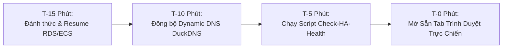

# Sổ Tay Vận Hành Trực Chiến Buổi Bảo Vệ Đồ Án (Defense Day HA Playbook)

> **Mục tiêu**: Đảm bảo hệ thống Production trên AWS của đồ án GYM Management luôn đạt mức sẵn sàng cao nhất (**High Availability - 99.9%**), cung cấp checklist thao tác trực chiến trước giờ bảo vệ và trang bị bộ công cụ cứu hộ khẩn cấp hoàn tất dưới 60 giây trong trường hợp phát sinh sự cố bất ngờ trước hội đồng.

---

## 1. Bảng Tổng Hợp Live URL Môi Trường Production

Hệ thống hỗ trợ cơ chế truy cập song song (Dual-Access Path): Đường dẫn tên miền thân thiện qua **Dynamic DNS Binding** (DuckDNS) và đường dẫn dự phòng trực tiếp qua AWS Application Load Balancer (ALB).

| Thành phần Dịch vụ | Loại Endpoint | URL Trực Tiếp (Live Endpoint) | Mục đích / Ghi chú Kiểm thử |
| :--- | :--- | :--- | :--- |
| **Frontend Web App (Chính)** | Dynamic DNS | `http://gym-management.duckdns.org` | Giao diện Single Page Application (React SPA) |
| **Frontend Web App (Dự phòng)** | ALB Raw CNAME | `http://gym-prod-alb-1299949163.ap-southeast-1.elb.amazonaws.com` | Dự phòng tức thì khi DNS nhà mạng gặp độ trễ cache |
| **Deep Backend Health Probe** | Actuator | `http://gym-management.duckdns.org/actuator/health` | Kiểm tra trạng thái Spring Boot, MySQL pool & dung lượng đĩa |
| **API Health (Tương thích ngược)** | REST API | `http://gym-management.duckdns.org/api/health` | Trả về status UP phục vụ monitoring đơn giản |
| **Backend Swagger API Docs** | OpenAPI UI | `http://gym-management.duckdns.org/swagger-ui/index.html` | Tài liệu trực quan toàn bộ RESTful API |
| **OpenAPI Specification (JSON)** | OpenAPI Spec | `http://gym-management.duckdns.org/v3/api-docs` | Tệp đặc tả OpenAPI 3.0 schema |
| **Frontend Artifact Version** | JSON Manifest | `http://gym-management.duckdns.org/version.json` | Xác thực **Artifact Version** và Git Commit SHA đang chạy |

---

## 2. Pre-flight Checklist Trước Giờ Thuyết Trình

Thực hiện quy trình kiểm tra theo dòng thời gian chuẩn hóa để đảm bảo hạ tầng đã hoàn toàn **Resume** và sẵn sàng 100%:



### ⏱️ T-15 Phút: Khởi Động & Xác Thực Hạ Tầng Cơ Sở
- [ ] **Kiểm tra trạng thái hạ tầng**: Đảm bảo hệ thống không ở trạng thái **Hibernate** hoặc **Pause**.
- [ ] **Đánh thức RDS Database**: Nếu RDS đang `stopped`, kích hoạt lệnh khởi động để cơ sở dữ liệu chuyển sang trạng thái `available` (mất ~90-120 giây).
- [ ] **Kiểm tra ECS Fargate**: Đảm bảo cả hai service `gym-prod-backend` và `gym-prod-frontend` đều có task ở trạng thái `RUNNING`.

### ⏱️ T-10 Phút: Đồng Bộ Hóa Mạng & Dynamic DNS
- [ ] **Xác thực ALB Target Groups**: Kiểm tra cả hai target group `gym-prod-backend-tg` và `gym-prod-frontend-tg` đều ghi nhận `healthy targets = 1`.
- [ ] **Đồng bộ Dynamic DNS Binding**: Xác nhận địa chỉ IPv4 của ALB đã được trỏ chính xác vào subdomain `gym-management.duckdns.org`.
- [ ] **Flush DNS Cache cục bộ**: Chạy `ipconfig /flushdns` trên laptop trình chiếu để dọn sạch cache DNS cũ.

### ⏱️ T-5 Phút: Chạy Script Giám Sát Đa Tầng (Multi-Tier Health Check)
- [ ] **Chạy script kiểm tra 3 tầng**:
  - Trên Windows: `.\scripts\check-ha-health.ps1 -HttpOnly`
  - Trên Linux/macOS: `./scripts/check-ha-health.sh --http-only`
- [ ] **Xác nhận 3 tầng đều xanh (PASS)**:
  - Tầng 1: Target group & ECS tasks running.
  - Tầng 2: Endpoint `/actuator/health` trả về HTTP 200, status `UP` (MySQL: UP, Disk: UP).
  - Tầng 3: Frontend root `/` trả về HTTP 200 và `/version.json` hiển thị đúng **Artifact Version**.

### ⏱️ T-0 Phút: Sẵn Sàng Trình Chiếu
- [ ] **Mở sẵn 3 Tab Trực Chiến trên trình duyệt**:
  1. *Tab 1*: Ứng dụng Gym Management (`http://gym-management.duckdns.org`).
  2. *Tab 2*: Swagger UI (`http://gym-management.duckdns.org/swagger-ui/index.html`).
  3. *Tab 3*: Actuator Health JSON (`http://gym-management.duckdns.org/actuator/health`).
- [ ] Mở sẵn một cửa sổ PowerShell / Terminal với quyền chạy các lệnh One-Liner cứu hộ khẩn cấp ở Phần 4 bên dưới.

---

## 3. Ma Trận Xử Lý Sự Cố Khẩn Cấp (Incident Response Matrix)

| Tình huống Sự cố | Dấu hiệu Nhận biết | Nguyên nhân Cốt lõi | Biện pháp Xử lý Tức thì (< 60s) | Phương án Dự phòng / Fallback |
| :--- | :--- | :--- | :--- | :--- |
| **DNS Failover / Resolution Lag** | Trình duyệt báo `DNS_PROBE_FINISHED_NXDOMAIN` hoặc không tải được `duckdns.org` | Cache DNS ISP trường đại học chưa cập nhật IP mới của ALB sau khi **Resume** | 1. Mở ngay link dự phòng **ALB Raw CNAME**.<br>2. Chạy lệnh cập nhật cưỡng bức DuckDNS qua cURL API.<br>3. Chạy `ipconfig /flushdns`. | Sử dụng trực tiếp ALB CNAME: `http://gym-prod-alb-...elb.amazonaws.com` |
| **Backend Task Crash / OOM Loop** | Trình duyệt báo lỗi HTTP 502 Bad Gateway; Endpoint `/actuator/health` không phản hồi | Task Backend bị Out-Of-Memory (OOM) hoặc gặp exception unhandled | Kích hoạt script cứu hộ nhanh: `.\scripts\quick-restart-prod.ps1 -SkipRds` để ECS Fargate tự động rolling replace container mới không gián đoạn. | Trình diễn tính năng tự phục hồi (Self-Healing) của ECS Task Definition trước hội đồng |
| **RDS Connectivity Loss / DB Stopped** | Backend báo lỗi `CannotGetJdbcConnectionException` hoặc Actuator báo `db: DOWN` | Instance RDS MySQL đang bị tạm dừng do chính sách tiết kiệm chi phí | Chạy lệnh đánh thức RDS: `aws rds start-db-instance --db-instance-identifier gym-prod-mysql --region ap-southeast-1` | Trình bày kiến trúc tiết kiệm chi phí **Hibernate** và thời gian tự phục hồi của hệ thống |
| **Network Latency / Packet Drop** | API response chậm bất thường (> 3000ms), kết nối bị timeout chập chờn | Nghẽn mạng wifi hội trường hoặc phân bổ traffic ALB sang multi-AZ chưa cân bằng | 1. Chạy script `check-ha-health.ps1` kiểm tra Target Group healthy latency.<br>2. Chuyển sang kết nối 4G/5G Hotspot ổn định cho máy thuyết trình.<br>3. Kiểm tra CloudWatch ALB metrics `TargetResponseTime`. | Sử dụng Swagger UI test trực tiếp payload nhỏ để minh chứng API hoạt động bình thường |
| **Frontend Asset 404 sau Release** | Trình duyệt tải trang trắng hoặc lỗi chunk javascript `Failed to fetch dynamically imported module` | Nginx cache file `index.html` cũ trỏ tới hash asset không còn tồn tại | Nhấn tổ hợp phím `Ctrl + F5` (hoặc `Cmd + Shift + R`) để bỏ qua browser cache; Nginx đã được thiết lập `no-store, no-cache` trên `index.html`. | Truy cập qua cửa sổ ẩn danh (Incognito Window) |

---

## 4. Danh Mục Lệnh One-Liner Cứu Hộ Khẩn Cấp (Emergency One-Liners)

Dán trực tiếp các lệnh dưới đây vào Terminal để thực thi ngay lập tức chỉ với 1 thao tác:

### 🚀 1. Kiểm tra Sức khỏe Hệ thống Toàn diện (3 Tầng)

**PowerShell (Windows):**
```powershell
.\scripts\check-ha-health.ps1 -HttpOnly
```

**Bash (Linux / macOS / Git Bash):**
```bash
./scripts/check-ha-health.sh --http-only
```

---

### ⚡ 2. Cứu Hộ Khẩn Cấp: Rolling Restart ECS Không Downtime (< 60s)

**PowerShell (Windows):**
```powershell
.\scripts\quick-restart-prod.ps1 -SkipRds
```

**Bash (Linux / macOS / Git Bash):**
```bash
./scripts/quick-restart-prod.sh --skip-rds
```

---

### 🗄️ 3. Đánh Thức RDS Database (Nếu Đang Bị Stopped)

**PowerShell (Windows):**
```powershell
aws rds start-db-instance --db-instance-identifier gym-prod-mysql --region ap-southeast-1; aws rds wait db-instance-available --db-instance-identifier gym-prod-mysql --region ap-southeast-1; Write-Host "RDS is READY!" -ForegroundColor Green
```

**Bash (Linux / macOS / Git Bash):**
```bash
aws rds start-db-instance --db-instance-identifier gym-prod-mysql --region ap-southeast-1 && aws rds wait db-instance-available --db-instance-identifier gym-prod-mysql --region ap-southeast-1 && echo "RDS is READY!"
```

---

### 🔄 4. Buộc Khởi Tạo Lại Backend Service Trên ECS Fargate (Force Deployment)

**PowerShell / Bash:**
```bash
aws ecs update-service --cluster gym-prod-cluster --service gym-prod-backend --force-new-deployment --region ap-southeast-1
```

---

### 🌐 5. Cập Nhật Thủ Công DuckDNS IP Từ ALB Public Hostname

**PowerShell (Windows):**
```powershell
$alb = "gym-prod-alb-1299949163.ap-southeast-1.elb.amazonaws.com"; $ip = ([System.Net.Dns]::GetHostAddresses($alb) | Where-Object { $_.AddressFamily -eq 'InterNetwork' })[0].IPAddressToString; (New-Object System.Net.WebClient).DownloadString("https://www.duckdns.org/update?domains=gym-management&token=$env:DUCKDNS_TOKEN&ip=$ip"); Write-Host "Bound DuckDNS -> $ip" -ForegroundColor Green
```

**Bash (Linux / macOS / Git Bash):**
```bash
ALB="gym-prod-alb-1299949163.ap-southeast-1.elb.amazonaws.com"; IP=$(nslookup $ALB | grep -A 2 "Name:" | grep "Address:" | awk '{print $2}' | head -n1); curl -s "https://www.duckdns.org/update?domains=gym-management&token=${DUCKDNS_TOKEN}&ip=${IP}" && echo -e "\nBound DuckDNS -> $IP"
```

---

### 📜 6. Theo Dõi Log Thời Gian Thực Backend (Live CloudWatch Logs)

**PowerShell / Bash:**
```bash
aws logs tail /ecs/gym-prod-backend --follow --format short --region ap-southeast-1
```

---

### 🧹 7. Dọn Sạch DNS Cache Máy Thuyết Trình

**PowerShell (Windows):**
```powershell
Clear-DnsClientCache; ipconfig /flushdns
```

**macOS:**
```bash
sudo dscacheutil -flushcache; sudo killall -HUP mDNSResponder
```
